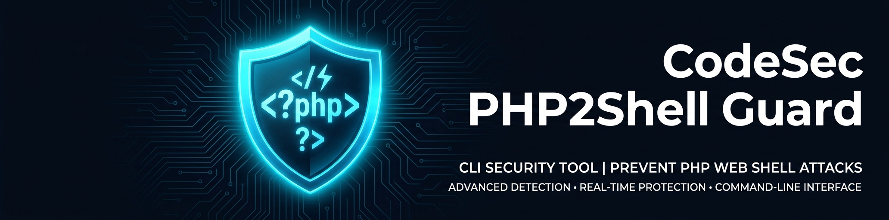

<div align="center">



# 🛡️ CodeSec PHP2Shell Guard

### Defend Your PHP Servers Against Critical Remote Code Execution Vulnerabilities

**One command. Instant visibility. Zero exploitation.**

[](https://github.com/altafpasha/php2shell-guard/releases)
[](LICENSE)
[](#requirements)
[](#what-is-php2shell)
[](#what-is-php2shell)
[](#what-is-php2shell)
[](#requirements)

[](https://github.com/altafpasha)
[](https://altafpasha.in)
[](https://x.com/altafpasha_h)

<br>

[🚀 Quick Start](#-quick-start-check-your-server-in-30-seconds) •
[📖 Usage Guide](#-usage-guide) •
[🔍 What is PHP2Shell?](#-what-is-php2shell) •
[❓ FAQ](#-frequently-asked-questions) •
[🤝 Contributing](#-contributing)

---

**⭐ If this tool helped secure your servers, please star this repository — it helps others find it!**

</div>

---

## 📋 Table of Contents

- [What is PHP2Shell?](#-what-is-php2shell)
- [Why You Need This Tool](#-why-you-need-this-tool)
- [Quick Start — Check Your Server in 30 Seconds](#-quick-start-check-your-server-in-30-seconds)
- [🎮 Interactive Menu (NEW!)](#-interactive-menu--just-run-it)
- [Requirements](#-requirements)
- [Installation](#-installation)
- [Usage Guide](#-usage-guide)
  - [Check a Specific PHP Version](#1--check-a-specific-php-version)
  - [Scan Your Local System](#2--scan-your-local-system-recommended)
  - [Check Multiple Versions at Once](#3--check-multiple-versions-at-once)
  - [Generate Reports (JSON & CSV)](#4--generate-reports-json--csv)
  - [Review PHP Error Logs](#5--review-php-error-logs)
  - [Get Step-by-Step Patch Instructions](#6--get-step-by-step-patch-instructions)
  - [Full Defensive Audit (All Features)](#7--full-defensive-audit-all-features-combined)
- [Understanding the Output](#-understanding-the-output)
- [Patched Versions Reference](#-patched-versions-reference)
- [All Command Options Reference](#-all-command-options-reference)
- [Real-World Scenarios](#-real-world-scenarios)
- [Frequently Asked Questions](#-frequently-asked-questions)
- [How It Works (Under the Hood)](#-how-it-works-under-the-hood)
- [Important Disclaimers](#%EF%B8%8F-important-disclaimers)
- [Contributing](#-contributing)
- [License](#-license)
- [Acknowledgments & References](#-acknowledgments--references)

---

## 🔍 What is PHP2Shell?

> **PHP2Shell** is the name given to two **critical memory-safety vulnerabilities** in the core PHP engine, officially tracked as **CVE-2026-109618** and **CVE-2026-109619**. They carry a **CVSS v4.0 score of 9.2 (CRITICAL)** and allow **unauthenticated remote code execution (RCE)** on any server running an unpatched PHP version.

### 🚨 Why This Matters

| Fact | Detail |
|------|--------|
| **Who is affected?** | Every PHP-powered website — WordPress, Laravel, Drupal, Joomla, Magento, custom apps |
| **How far back?** | Vulnerable versions date back to PHP 5.4 |
| **Pre-auth?** | Yes — attackers don't need a login or session |
| **What can attackers do?** | Execute arbitrary code on your server, steal data, install backdoors |
| **Is a patch available?** | ✅ Yes — upgrade to the fixed versions listed below |

### 🧪 The Two Vulnerabilities Explained Simply

<table>
<tr>
<th>CVE</th>
<th>Name</th>
<th>What Happens (in Plain English)</th>
</tr>
<tr>
<td><strong>CVE-2026-109618</strong></td>
<td>RCE via Out-of-Memory</td>
<td>When PHP runs out of memory, it tries to clean up — but leaves some internal data half-initialized. An attacker can force this crash and take control during cleanup.</td>
</tr>
<tr>
<td><strong>CVE-2026-109619</strong></td>
<td>RCE via Stale Global State</td>
<td>PHP keeps "global notes" between requests. Under specific crash conditions, old notes aren't erased properly. Attackers can exploit these leftover notes to run their code.</td>
</tr>
</table>

> **Bottom line:** If you run PHP and haven't patched — you're at risk. This tool tells you exactly where you stand.

---

## 💡 Why You Need This Tool

<table>
<tr>
<td>✅</td>
<td><strong>Instant answers</strong> — Know in seconds if your PHP version is vulnerable</td>
</tr>
<tr>
<td>✅</td>
<td><strong>Zero risk</strong> — This tool does NOT exploit anything. It only checks version numbers</td>
</tr>
<tr>
<td>✅</td>
<td><strong>No installation</strong> — Single Bash script, no dependencies, no packages to install</td>
</tr>
<tr>
<td>✅</td>
<td><strong>Non-technical friendly</strong> — Clear "vulnerable / safe" output with plain-English guidance</td>
</tr>
<tr>
<td>✅</td>
<td><strong>Reports for your boss</strong> — Export results to JSON or CSV for compliance and reporting</td>
</tr>
<tr>
<td>✅</td>
<td><strong>Batch scanning</strong> — Check hundreds of PHP versions from a file in one command</td>
</tr>
<tr>
<td>✅</td>
<td><strong>Log analysis</strong> — Scan your PHP error logs for suspicious crash patterns</td>
</tr>
<tr>
<td>✅</td>
<td><strong>Patch guidance</strong> — Get step-by-step update commands for your specific OS</td>
</tr>
</table>

---

## 🚀 Quick Start — Check Your Server in 30 Seconds

> **No experience needed!** Just copy and paste these commands into your server terminal.

### Step 1: Download the tool

```bash
git clone https://github.com/altafpasha/php2shell-guard.git
cd php2shell-guard
```

### Step 2: Make it executable

```bash
chmod +x codesec-php2shell-guard.sh
```

### Step 3: Launch the interactive menu

```bash
./codesec-php2shell-guard.sh
```

**That's it!** A beautiful interactive menu will appear — just pick a number! 🎉

> 💡 You can also run with flags directly: `./codesec-php2shell-guard.sh --system`

---

## 🎮 Interactive Menu — Just Run It!

> **New in v2.1!** Run the tool without any arguments to get a beautiful interactive menu. No need to memorize flags — just pick a number!

```bash
./codesec-php2shell-guard.sh
```

The menu gives you **10 options** to choose from:

```
  ╔═══════════════════════════════════════════════════════════╗
  ║                    SELECT AN OPTION                       ║
  ╠═══════════════════════════════════════════════════════════╣
  ║                                                           ║
  ║  [1]  🖥️   Scan Local System                              ║
  ║  [2]  🔢  Check Specific Version                          ║
  ║  [3]  📁  Batch Check (File)                              ║
  ║  [4]  📊  Generate Reports (JSON/CSV)                     ║
  ║  [5]  📜  Review PHP Error Log                            ║
  ║  [6]  🩹  Patch Guidance                                  ║
  ║  [7]  🔒  Full Defensive Audit                            ║
  ║  [8]  📋  Patched Versions Reference                      ║
  ║  [9]  ❓  Help & Usage Info                               ║
  ║  [0]  🚪  Exit                                            ║
  ║                                                           ║
  ╚═══════════════════════════════════════════════════════════╝

  ⮞  Enter your choice [0-9]:
```

### ✨ Features of the Interactive Menu

- **🎨 Color-coded output** — Vulnerable versions in red, safe versions in green
- **🏷️ Status badges** — Instant visual `✘ VULNERABLE` or `✔ LIKELY FIXED` labels
- **📊 Guided exports** — The menu walks you through saving JSON/CSV reports
- **🔄 Loop mode** — Returns to the menu after each action, run multiple checks
- **🎯 Zero memorization** — No need to remember CLI flags
- **📱 Works everywhere** — Any terminal that supports ANSI colors

<details>
<summary>📋 <strong>What the output looks like (click to expand)</strong></summary>

```
PHP/web-server process inventory (not proof of exposure):
12345 php-fpm: master process (/etc/php/8.3/fpm/php-fpm.conf)

Detected package managers:
 - apt-get (Debian/Ubuntu family)

=== CodeSec PHP2Shell Guard v2.0.0 ===
Advisory: https://www.php.net/security/

PHP version: 8.3.35
Source: local PHP CLI
Status: potentially_vulnerable
Reason: Below upstream fix threshold; patch and verify vendor advisory.
Upstream threshold: 8.3.36

Reminder: patching fixes the vulnerability; log review alone cannot.
Review official PHP and operating-system vendor advisories.
```

**Translation:** Your PHP 8.3.35 is **VULNERABLE** — you need to update to at least 8.3.36.

</details>

---

## 📦 Requirements

| Requirement | Minimum | Notes |
|------------|---------|-------|
| **Operating System** | Linux, macOS, or Windows (WSL) | Any Unix-like system |
| **Bash** | Version 4.0+ | Pre-installed on most systems |
| **Python 3** | Any version | Only needed for `--json-out` (JSON export) |
| **PHP CLI** | Not required | Only needed for `--system` auto-detection |

> 💡 **Tip:** Don't know if you have Bash? Run `bash --version` in your terminal. If you see a version number, you're good!

---

## 📥 Installation

Choose the method that works best for you:

### Method 1: Git Clone (Recommended)

```bash
git clone https://github.com/altafpasha/php2shell-guard.git
cd php2shell-guard
chmod +x codesec-php2shell-guard.sh
```

### Method 2: Direct Download (Single File)

```bash
curl -sLO https://raw.githubusercontent.com/altafpasha/php2shell-guard/main/codesec-php2shell-guard.sh
chmod +x codesec-php2shell-guard.sh
```

### Method 3: Wget

```bash
wget https://raw.githubusercontent.com/altafpasha/php2shell-guard/main/codesec-php2shell-guard.sh
chmod +x codesec-php2shell-guard.sh
```

### ✅ Verify Installation

```bash
./codesec-php2shell-guard.sh --help
```

You should see the help text with all available options.

---

## 📖 Usage Guide

Below are the most common ways to use the tool, with step-by-step instructions and example output for each.

---

### 1. 🔢 Check a Specific PHP Version

> **Use this when:** You know the PHP version of a remote server, a container image, or a system you can't run the tool on directly.

```bash
./codesec-php2shell-guard.sh --php-version 8.3.35
```

<details>
<summary><strong>📋 Example Output</strong></summary>

```
=== CodeSec PHP2Shell Guard v2.0.0 ===
Advisory: https://www.php.net/security/

PHP version: 8.3.35
Source: user input
Status: potentially_vulnerable
Reason: Below upstream fix threshold; patch and verify vendor advisory.
Upstream threshold: 8.3.36

Reminder: patching fixes the vulnerability; log review alone cannot.
Review official PHP and operating-system vendor advisories.
```

</details>

**What does this mean?**
- `potentially_vulnerable` → ⚠️ Your PHP version is **below the security fix**. Update immediately!
- `likely_fixed` → ✅ Your version is **at or above** the patched version. You're probably safe.

---

### 2. 🖥️ Scan Your Local System (Recommended)

> **Use this when:** You're logged into a server and want to automatically check what PHP version is running.

```bash
./codesec-php2shell-guard.sh --system
```

**What it does:**
1. 🔍 Detects PHP version installed on this machine
2. 📋 Lists running PHP/web-server processes (Apache, Nginx+PHP-FPM, etc.)
3. 🔧 Shows which package manager is available for updates
4. ✅ Tells you if your version is safe or vulnerable

---

### 3. 📁 Check Multiple Versions at Once

> **Use this when:** You manage multiple servers and want to check all PHP versions in one go.

**Step 1:** Create a text file with one PHP version per line:

```bash
# Create the file (replace with your actual versions)
cat > versions.txt << 'EOF'
8.3.35
8.4.27
8.5.11
8.2.30
8.4.25
EOF
```

> 💡 **Tip:** You can add comments with `#` and blank lines — they'll be ignored.
>
> ```
> # Production servers
> 8.3.35
> 8.4.26
>
> # Staging
> 8.5.11
> ```

**Step 2:** Run the check:

```bash
./codesec-php2shell-guard.sh --versions-file versions.txt
```

<details>
<summary><strong>📋 Example Output</strong></summary>

```
=== CodeSec PHP2Shell Guard v2.0.0 ===
Advisory: https://www.php.net/security/

PHP version: 8.3.35
Source: versions file
Status: potentially_vulnerable
Reason: Below upstream fix threshold; patch and verify vendor advisory.
Upstream threshold: 8.3.36

PHP version: 8.4.27
Source: versions file
Status: likely_fixed
Reason: At or above upstream threshold; verify package origin and running service.
Upstream threshold: 8.4.27

PHP version: 8.5.11
Source: versions file
Status: potentially_vulnerable
Reason: Below upstream fix threshold; patch and verify vendor advisory.
Upstream threshold: 8.5.12

PHP version: 8.2.30
Source: versions file
Status: potentially_vulnerable
Reason: Below upstream fix threshold; patch and verify vendor advisory.
Upstream threshold: 8.2.35

PHP version: 8.4.25
Source: versions file
Status: potentially_vulnerable
Reason: Below upstream fix threshold; patch and verify vendor advisory.
Upstream threshold: 8.4.27

Reminder: patching fixes the vulnerability; log review alone cannot.
Review official PHP and operating-system vendor advisories.
```

</details>

---

### 4. 📊 Generate Reports (JSON & CSV)

> **Use this when:** You need to share results with your team, manager, or compliance auditors.

#### JSON Report

```bash
./codesec-php2shell-guard.sh --system --json-out report.json
```

<details>
<summary><strong>📋 Example JSON Output</strong></summary>

```json
{
  "tool": "CodeSec PHP2Shell Guard",
  "tool_version": "2.0.0",
  "advisory": "https://www.php.net/security/",
  "results": [
    {
      "php_version": "8.3.35",
      "status": "potentially_vulnerable",
      "reason": "Below upstream fix threshold; patch and verify vendor advisory.",
      "upstream_fix_threshold": "8.3.36"
    }
  ],
  "limitations": [
    "Version-only upstream threshold check",
    "Vendor backports are not detected",
    "CLI version may differ from web runtime",
    "No remote scanning or exploitation",
    "Log indicators are not proof of compromise"
  ]
}
```

</details>

#### CSV Report

```bash
./codesec-php2shell-guard.sh --system --csv-out report.csv
```

> 💡 **Tip:** CSV files open directly in **Excel, Google Sheets, or LibreOffice** — perfect for sharing with non-technical team members.

#### Both Reports at Once

```bash
./codesec-php2shell-guard.sh \
  --system \
  --json-out report.json \
  --csv-out report.csv
```

---

### 5. 📜 Review PHP Error Logs

> **Use this when:** You want to check if your PHP error logs show signs of crash patterns related to the vulnerability.

```bash
./codesec-php2shell-guard.sh \
  --php-version 8.3.35 \
  --log-file /var/log/php8.3-fpm.log
```

**What it looks for:** Memory exhaustion errors, segfaults, unexpected crashes, and multipart anomalies — all potential indicators of exploitation attempts.

<details>
<summary><strong>📋 Example Output</strong></summary>

```
=== CodeSec PHP2Shell Guard v2.0.0 ===
Advisory: https://www.php.net/security/

PHP version: 8.3.35
Source: user input
Status: potentially_vulnerable
Reason: Below upstream fix threshold; patch and verify vendor advisory.
Upstream threshold: 8.3.36

=== Log review indicators ===
These patterns are leads for human review, not proof of compromise.
/var/log/php8.3-fpm.log:142: PHP Fatal error: Allowed memory size exhausted
/var/log/php8.3-fpm.log:287: child exited on signal 11 (SIGSEGV)
```

</details>

> ⚠️ **Important:** Log matches are **leads for investigation**, NOT proof of an attack. Always have a security professional review the findings.

#### Common Log File Locations

| System | Log Path |
|--------|----------|
| **Ubuntu/Debian (PHP-FPM)** | `/var/log/php8.x-fpm.log` |
| **CentOS/RHEL** | `/var/log/php-fpm/error.log` |
| **Apache** | `/var/log/apache2/error.log` or `/var/log/httpd/error_log` |
| **Nginx + PHP-FPM** | `/var/log/php-fpm/www-error.log` |
| **macOS (Homebrew)** | `/opt/homebrew/var/log/php-fpm.log` |
| **Custom** | Check your `php.ini` → `error_log` directive |

---

### 6. 🩹 Get Step-by-Step Patch Instructions

> **Use this when:** The tool says you're vulnerable and you need help updating.

```bash
./codesec-php2shell-guard.sh --system --patch-guide
```

<details>
<summary><strong>📋 Example Patch Guidance Output</strong></summary>

```
=== Patch guidance ===
1. Back up the system and confirm your supported package source.
2. Update PHP from the official OS/vendor repository or PHP release.
3. Restart the actual PHP runtime and web-server workers.
4. Recheck the runtime version and vendor package changelog.
5. Review logs and investigate suspected compromise separately.

Debian/Ubuntu: sudo apt update && sudo apt upgrade
Fedora/RHEL:   sudo dnf update
Alpine:        sudo apk update && sudo apk upgrade
macOS/Homebrew: brew update && brew upgrade php

Commands above update packages broadly; review proposed changes first.
Do not assume these commands update every custom PHP installation.
PHP release information: https://www.php.net/downloads.php
```

</details>

---

### 7. 🔒 Full Defensive Audit (All Features Combined)

> **Use this when:** You want the most thorough check possible — system scan, log review, reports, and patch guidance all at once.

```bash
./codesec-php2shell-guard.sh \
  --system \
  --patch-guide \
  --log-file /var/log/php8.3-fpm.log \
  --json-out audit-report.json \
  --csv-out audit-report.csv
```

This single command will:
1. ✅ Auto-detect and check your local PHP version
2. 📋 List all running PHP/web-server processes
3. 🔍 Scan your error logs for suspicious patterns
4. 🩹 Display step-by-step patching instructions
5. 📊 Save results as JSON and CSV files

---

## 🎯 Understanding the Output

The tool reports one of four status levels:

| Status | Icon | Meaning | What To Do |
|--------|------|---------|------------|
| `potentially_vulnerable` | 🔴 | Your PHP version is **below** the patched version | **Update immediately!** Follow the patch guide |
| `likely_fixed` | 🟢 | Your PHP version is **at or above** the patched version | Verify the update is applied and services restarted |
| `unknown_or_legacy` | 🟡 | You're running an **old/EOL** PHP branch (e.g., 7.x) | Check your vendor's security status immediately |
| `unknown` | ⚪ | Version couldn't be determined or is on an untracked branch | Manually verify against the official advisory |

---

## ✅ Patched Versions Reference

Update your PHP to **at least** these versions to be protected:

| PHP Branch | Minimum Safe Version | Status |
|-----------|---------------------|--------|
| **PHP 8.5** | `8.5.12` | 🟢 Patched |
| **PHP 8.4** | `8.4.27` | 🟢 Patched |
| **PHP 8.3** | `8.3.36` | 🟢 Patched |
| **PHP 8.2** | `8.2.35` | 🟢 Patched |
| PHP 8.1 and below | — | 🔴 EOL — upgrade to a supported branch |

> ⚠️ **PHP 8.1, 8.0, 7.x, and older** are End-of-Life (EOL) and do **not** receive official security patches. If you're running these versions, you must upgrade to a supported branch or use vendor-extended-support builds.

---

## 📚 All Command Options Reference

```
Usage:
  ./codesec-php2shell-guard.sh [OPTIONS]

Options:
  --system                 Auto-detect and check the local PHP installation
  --php-version VERSION    Manually check a specific PHP version string
  --versions-file FILE     Check multiple PHP versions from a text file
  --json-out FILE          Export results as a JSON file
  --csv-out FILE           Export results as a CSV file
  --patch-guide            Display step-by-step upgrade instructions
  --log-file FILE          Scan a PHP error log for suspicious patterns
  --no-process-check       Skip the running process inventory
  -h, --help               Show help message
```

### Combining Options

All options can be combined freely:

```bash
# System check + patch guide
./codesec-php2shell-guard.sh --system --patch-guide

# Manual version + log review + JSON export
./codesec-php2shell-guard.sh --php-version 8.4.25 --log-file /var/log/php-error.log --json-out results.json

# Batch versions + both reports
./codesec-php2shell-guard.sh --versions-file servers.txt --json-out report.json --csv-out report.csv

# System check without process listing (useful in containers)
./codesec-php2shell-guard.sh --system --no-process-check
```

---

## 🌍 Real-World Scenarios

### 👩‍💻 Scenario 1: Sysadmin Checking a Production Server

```bash
# SSH into your server
ssh admin@production-server.example.com

# Download and run
curl -sLO https://raw.githubusercontent.com/altafpasha/php2shell-guard/main/codesec-php2shell-guard.sh
chmod +x codesec-php2shell-guard.sh
./codesec-php2shell-guard.sh --system --patch-guide
```

### 🏢 Scenario 2: Security Team Auditing 50+ Servers

```bash
# Collect PHP versions from all servers into a file
for host in $(cat server-list.txt); do
  ssh "$host" "php -r 'echo PHP_VERSION;'" 2>/dev/null
done > all-versions.txt

# Run batch check with reports
./codesec-php2shell-guard.sh --versions-file all-versions.txt \
  --json-out fleet-audit.json \
  --csv-out fleet-audit.csv
```

### 🐳 Scenario 3: Checking Docker Container Images

```bash
# Get PHP version from a container image
docker run --rm php:8.3-fpm php -r 'echo PHP_VERSION;'
# Output: 8.3.35

# Check it
./codesec-php2shell-guard.sh --php-version 8.3.35
```

### 🔁 Scenario 4: CI/CD Pipeline Integration

```yaml
# Add to your GitHub Actions workflow
- name: PHP2Shell Security Check
  run: |
    curl -sLO https://raw.githubusercontent.com/altafpasha/php2shell-guard/main/codesec-php2shell-guard.sh
    chmod +x codesec-php2shell-guard.sh
    ./codesec-php2shell-guard.sh --system --json-out php-security-report.json

- name: Upload Security Report
  uses: actions/upload-artifact@v4
  with:
    name: php-security-report
    path: php-security-report.json
```

---

## ❓ Frequently Asked Questions

<details>
<summary><strong>🤔 Is this tool safe to run on production servers?</strong></summary>

**Yes, absolutely.** This tool only reads version strings and log files. It does not:
- Connect to the internet
- Modify any files or settings
- Send any data anywhere
- Attempt any exploitation

It's a read-only diagnostic script.
</details>

<details>
<summary><strong>🤔 Do I need root/sudo access?</strong></summary>

**No** for basic usage. You only need `sudo` if:
- Your PHP log files are owned by root (for `--log-file`)
- Your PHP binary is not in a standard `PATH` location
</details>

<details>
<summary><strong>🤔 Will this detect vendor-backported patches (e.g., Ubuntu/Debian patches)?</strong></summary>

**No.** This tool compares against upstream PHP version numbers only. Linux distributions sometimes backport security fixes to older versions without changing the version number (e.g., Ubuntu might patch 8.3.35 without calling it 8.3.36). Always check your distribution's security tracker as well:
- Ubuntu: https://ubuntu.com/security/cves
- Debian: https://security-tracker.debian.org/
- Red Hat: https://access.redhat.com/security/
</details>

<details>
<summary><strong>🤔 What if I'm running PHP 7.x or older?</strong></summary>

PHP 7.x and below are **End-of-Life** and don't receive security patches from php.net. The tool will flag these as `unknown_or_legacy`. You should:
1. Plan an upgrade to PHP 8.3+ as soon as possible
2. Check if your hosting provider offers extended support
3. Consult a security professional for interim hardening
</details>

<details>
<summary><strong>🤔 Can I use this on Windows?</strong></summary>

**Yes**, through **Windows Subsystem for Linux (WSL)**:
```bash
# Open WSL terminal, then:
git clone https://github.com/altafpasha/php2shell-guard.git
cd php2shell-guard
chmod +x codesec-php2shell-guard.sh
./codesec-php2shell-guard.sh --php-version 8.3.35
```
</details>

<details>
<summary><strong>🤔 The tool says "likely_fixed" — am I 100% safe?</strong></summary>

`likely_fixed` means your PHP version number is at or above the patched threshold. However, you should also:
1. **Verify the package origin** — make sure the update came from your official OS repo or php.net
2. **Restart PHP services** — old vulnerable processes may still be running in memory
3. **Check vendor changelog** — confirm the specific CVE patches are included
</details>

<details>
<summary><strong>🤔 How is this different from vulnerability scanners like Nessus or Qualys?</strong></summary>

This tool is **focused, fast, and free**. Enterprise scanners are comprehensive but require setup, licensing, and network access. Use this tool for:
- Quick first-response triage
- Environments where you can't install a full scanner
- Verifying that patches were applied after remediation
- Generating quick reports for incident response
</details>

<details>
<summary><strong>🤔 Can this tool scan remote servers?</strong></summary>

**Not directly.** It runs locally. For remote servers, either:
1. SSH into the server and run it there
2. Collect PHP versions remotely and use `--versions-file` (see [Scenario 2](#-scenario-2-security-team-auditing-50-servers))
</details>

---

## ⚙️ How It Works (Under the Hood)

```
┌─────────────────────────────────────────────────────────────────┐
│                    CodeSec PHP2Shell Guard                       │
├─────────────────────────────────────────────────────────────────┤
│                                                                 │
│  Input Sources:                                                 │
│  ┌──────────────┐  ┌──────────────┐  ┌──────────────────────┐  │
│  │ --php-version │  │ --system     │  │ --versions-file      │  │
│  │ (manual)      │  │ (auto-detect)│  │ (batch file)         │  │
│  └──────┬───────┘  └──────┬───────┘  └──────────┬───────────┘  │
│         │                 │                      │              │
│         └─────────────────┼──────────────────────┘              │
│                           │                                     │
│                           ▼                                     │
│              ┌────────────────────────┐                         │
│              │  Version Comparison    │                         │
│              │  Engine (Bash)         │                         │
│              │                        │                         │
│              │  Compares against      │                         │
│              │  known-fixed upstream  │                         │
│              │  thresholds per branch │                         │
│              └────────────┬───────────┘                         │
│                           │                                     │
│              ┌────────────▼───────────┐                         │
│              │  Status Classification │                         │
│              │                        │                         │
│              │  • potentially_        │                         │
│              │    vulnerable          │                         │
│              │  • likely_fixed        │                         │
│              │  • unknown_or_legacy   │                         │
│              │  • unknown             │                         │
│              └────────────┬───────────┘                         │
│                           │                                     │
│         ┌─────────────────┼──────────────────────┐              │
│         │                 │                      │              │
│         ▼                 ▼                      ▼              │
│  ┌─────────────┐  ┌─────────────┐  ┌──────────────────────┐   │
│  │ Terminal     │  │ JSON Export │  │ CSV Export           │   │
│  │ Output      │  │ (Python 3)  │  │ (native Bash)       │   │
│  └─────────────┘  └─────────────┘  └──────────────────────┘   │
│                                                                 │
│  Optional Modules:                                              │
│  ┌─────────────────┐  ┌─────────────────────────┐              │
│  │ --log-file      │  │ --patch-guide           │              │
│  │ (grep patterns) │  │ (OS-specific commands)  │              │
│  └─────────────────┘  └─────────────────────────┘              │
│                                                                 │
└─────────────────────────────────────────────────────────────────┘
```

**Key design principles:**
- 🚫 **No network calls** — everything runs offline
- 🚫 **No exploitation** — purely defensive version comparison
- 🚫 **No file writes** — except for explicit `--json-out` / `--csv-out`
- ✅ **Transparent** — fully readable Bash script, no compiled binaries

---

## ⚠️ Important Disclaimers

> **This tool is provided for defensive security assessment only.**

1. **Not a guarantee of safety** — `likely_fixed` status is based on upstream version thresholds. Vendor-specific backports, custom compilations, and running-vs-installed version mismatches require additional verification.
2. **Not an exploitation tool** — This script does not probe, attack, or test exploitability of any target.
3. **Log indicators ≠ proof of compromise** — Matching log patterns are leads for human investigation, not confirmation of an attack.
4. **CLI version may differ from runtime** — The PHP version in your terminal may differ from the version serving web requests (e.g., different PHP-FPM pool configs).
5. **Always consult official sources** — Use the [PHP Security Advisory page](https://www.php.net/security/) and your OS vendor's security tracker for authoritative guidance.

---

## 🤝 Contributing

Contributions are welcome and appreciated! Here's how to help:

### Ways to Contribute

- 🐛 **Report bugs** — Open an [issue](https://github.com/altafpasha/php2shell-guard/issues)
- 💡 **Suggest features** — We'd love to hear your ideas
- 📝 **Improve documentation** — Fix typos, add translations, improve examples
- 🔧 **Submit code** — Fork, branch, and open a Pull Request

### Development Guidelines

1. Fork the repository
2. Create a feature branch (`git checkout -b feature/amazing-feature`)
3. Make your changes and test them
4. Commit with clear messages (`git commit -m 'Add amazing feature'`)
5. Push to your branch (`git push origin feature/amazing-feature`)
6. Open a Pull Request

### Code Standards

- Shell scripts must pass `shellcheck` without errors
- All changes must maintain backward compatibility
- Update documentation for any new features

---

## 📄 License

This project is licensed under the **MIT License** — see the [LICENSE](LICENSE) file for details.

You are free to use, modify, and distribute this tool for personal, commercial, or educational purposes.

---

## 🙏 Acknowledgments & References

- [PHP Official Security Advisories](https://www.php.net/security/)
- [CVE-2026-109618 — NVD Entry](https://nvd.nist.gov/vuln/detail/CVE-2026-109618)
- [CVE-2026-109619 — NVD Entry](https://nvd.nist.gov/vuln/detail/CVE-2026-109619)
- [PHP Downloads & Release Notes](https://www.php.net/downloads.php)
- The open-source security community for continuous vigilance

---

<div align="center">

### 🛡️ Stay Patched. Stay Protected. Stay Vigilant.

**Made with ❤️ by [Altaf Pasha](https://altafpasha.in) for the security community**

[](https://github.com/altafpasha/php2shell-guard)
[](https://x.com/altafpasha_h)
[](https://altafpasha.in)

</div>

---

<div align="center">

### 👤 About the Author

| | |
|---|---|
| **Name** | Altaf Pasha |
| **Website** | [altafpasha.in](https://altafpasha.in) |
| **X (Twitter)** | [@altafpasha_h](https://x.com/altafpasha_h) |
| **GitHub** | [github.com/altafpasha](https://github.com/altafpasha) |

</div>

<!-- SEO: PHP vulnerability scanner, PHP2Shell CVE checker, CVE-2026-109618, CVE-2026-109619, PHP security audit tool, PHP remote code execution checker, PHP RCE vulnerability, PHP version checker, PHP security tool, PHP patch checker, PHP-FPM vulnerability, WordPress security, Laravel security, Drupal security, Joomla security, PHP web shell detection, PHP memory exhaustion exploit, PHP OOM vulnerability, server security audit, penetration testing tools, cybersecurity CLI tools, PHP security hardening, CVSS 9.2 PHP, critical PHP vulnerability 2026, PHP security scanner open source, bash security script, PHP version audit, web server security check, PHP-CGI vulnerability, FrankenPHP security, altaf pasha, altafpasha -->
